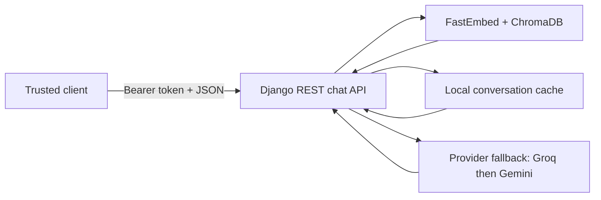

# Batam RAG Backend

**Historical Django REST prototype for retrieval-augmented tourism chat.**

  

> **Retired implementation.** This repository is a supporting portfolio project and is not the active backend of [Hallo Batam AI](https://github.com/fahmifaldi61-tech/wisatabatam). Do not expose this prototype publicly.

## Overview

The original backend explored bilingual tourism chat using sample travel documents, vector similarity search, conversation memory and AI-provider fallback. This cleanup preserves the architecture while reducing unsafe defaults and separating responsibilities.

## Architecture



- Top-three similarity search over the local sample index.
- Indonesian/English prompt selection and bounded conversation history (15 turns, 24-hour TTL).
- Primary and secondary Groq credentials followed by Gemini; missing keys are skipped.
- Shared bearer-token access, signed session handles and local request throttling.
- Provider timeouts, sanitized failures and non-destructive ingestion with deterministic chunk IDs.

The sample corpus is not validated for current travel prices or availability. Retrieval can be unavailable, in which case the provider receives no retrieved context.

## Technology

Python 3.11, Django 5.2, Django REST Framework, LangChain Community, FastEmbed, ChromaDB, OpenAI SDK (Groq-compatible client), Google Gen AI SDK, SQLite, Gunicorn and GitHub Actions.

## Repository structure

```text
api/
  views.py                  # Request validation and response orchestration
  services/
    conversation.py         # Signed sessions and bounded prompt history
    providers.py            # Lazy provider clients and fallback
    retrieval.py            # Shared embedding/index configuration
  tests.py                  # Mocked API and fallback tests
backend_pariwisata/          # Django project settings and routes
data_wisata/info_wisata.txt  # Historical sample corpus
docs/SECURITY.md             # Security and retirement notes
ingest.py                    # Non-destructive index ingestion
isi_data.py                  # Compatibility entry point
.env.example
requirements.txt
```

## Local setup

Requires Python 3.11 and Git.

```bash
git clone https://github.com/fahmifaldi61-tech/wisatabatam-backend..git
cd wisatabatam-backend.
python -m venv .venv
```

Activate the environment: PowerShell `.venv/Scripts/Activate.ps1`, or macOS/Linux `source .venv/bin/activate`.

```bash
python -m pip install -r requirements.txt
```

Copy `.env.example` to `.env` (PowerShell: `Copy-Item .env.example .env`; Unix: `cp .env.example .env`). Generate a separate random value for each of DJANGO_SECRET_KEY and CHAT_API_TOKEN using `python -c "import secrets; print(secrets.token_urlsafe(64))"`. Set at least one authorized AI provider key locally. Never commit real keys.

```bash
python manage.py migrate
python manage.py check
python manage.py test
python ingest.py
python manage.py runserver 127.0.0.1:8000
```

The first ingestion may download an embedding model. Re-running unchanged input uses stable chunk IDs; when changing the corpus, use a new RAG_COLLECTION or index directory to avoid stale documents. Existing historical indexes are not deleted or automatically migrated.

### API contract

`POST /api/chat/` accepts JSON with `message` (1–2000 characters), `language` (id/en) and optional signed `session_id` from a prior response. Use the configured token in the Authorization header. For example, from PowerShell with a separately set environment variable:

```powershell
$headers = @{ Authorization = "Bearer $env:CHAT_API_TOKEN" }
$body = @{ message = "What is Barelang Bridge?"; language = "en" } | ConvertTo-Json
Invoke-RestMethod -Method Post -Uri "http://127.0.0.1:8000/api/chat/" -Headers $headers -ContentType "application/json" -Body $body
```

Response fields: response, provider_used, language, sources, session_id. Old unsigned session IDs are rejected. The shared token is intended for trusted clients only, not browser JavaScript.

### Verification

```bash
python -m pip check
python manage.py check
python manage.py test
```

The automated tests mock external AI/retrieval calls and do not require provider credentials or model downloads. Dependency ranges are not a complete lockfile. Real-provider compatibility, embedding retrieval quality and public deployment are outside the verified scope.

## Showcase

[INSERT SCREENSHOT / DEMO GIF HERE: local API request and sanitized response, with credentials hidden]

[INSERT SCREENSHOT / DEMO GIF HERE: successful offline test run]

## Security and project history

Read [security notes](docs/SECURITY.md) before running the application. Never deploy the historical configuration or reuse previously committed secrets. This local prototype is not intended to replace the Supabase architecture.

[Current Hallo Batam AI project](https://github.com/fahmifaldi61-tech/wisatabatam) · [Developer portfolio](https://github.com/fahmifaldi61-tech)
